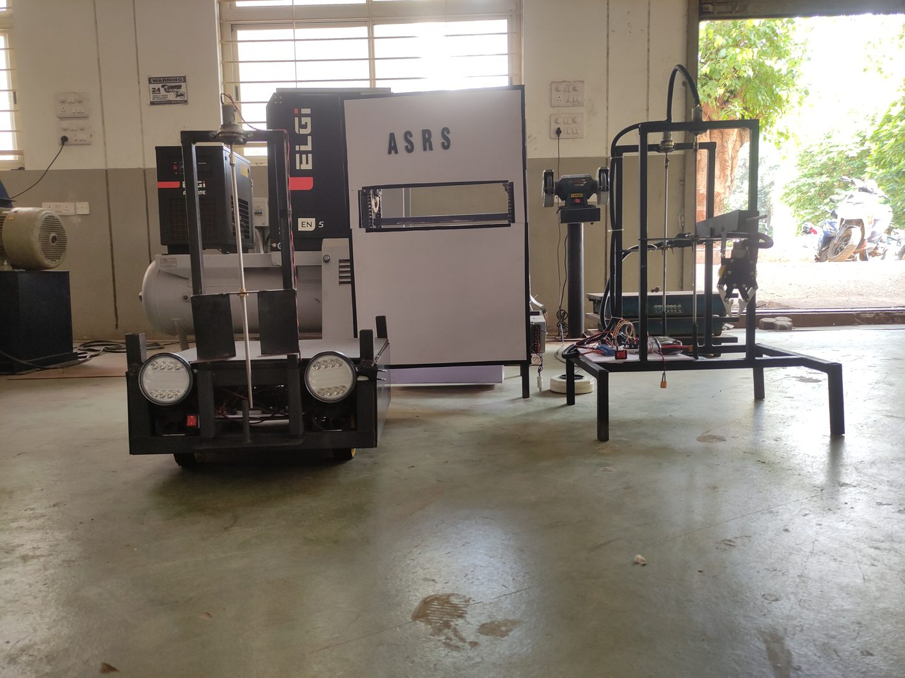
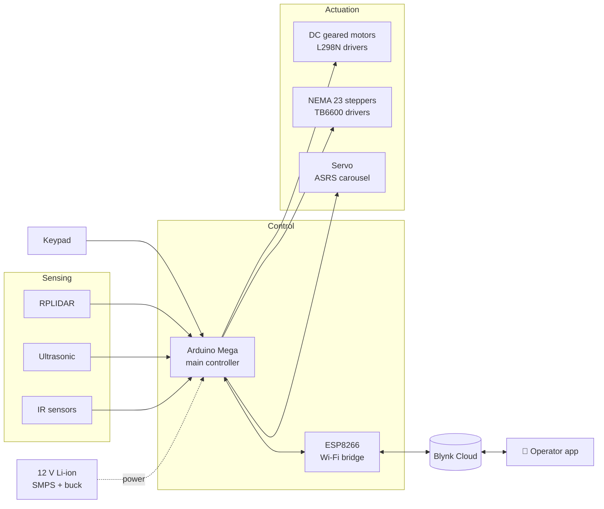
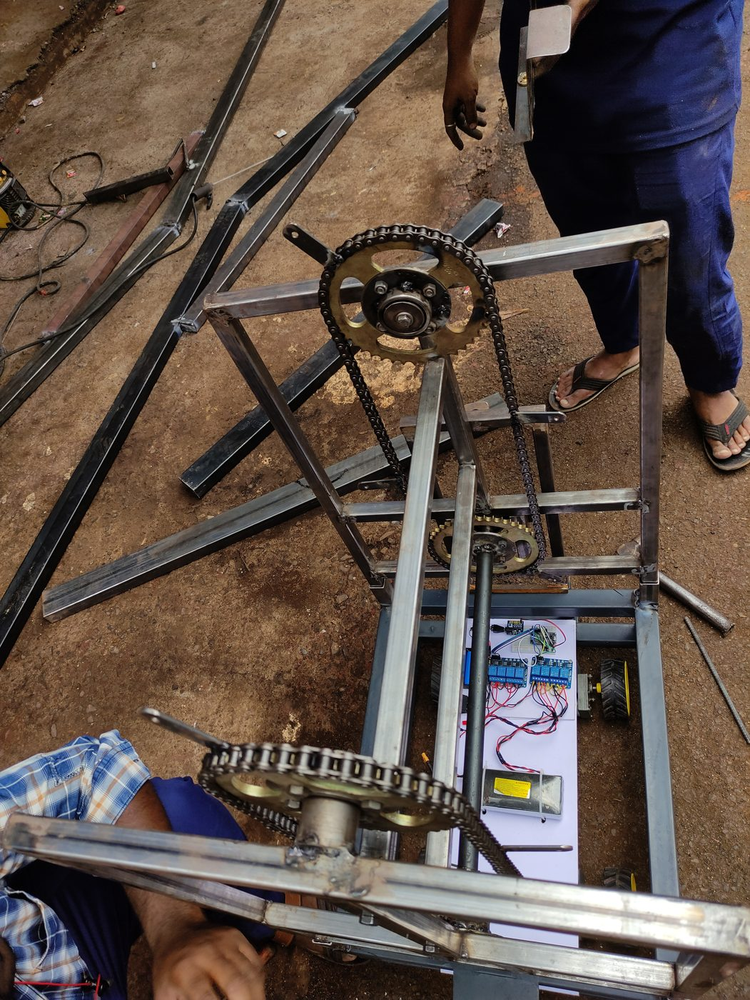
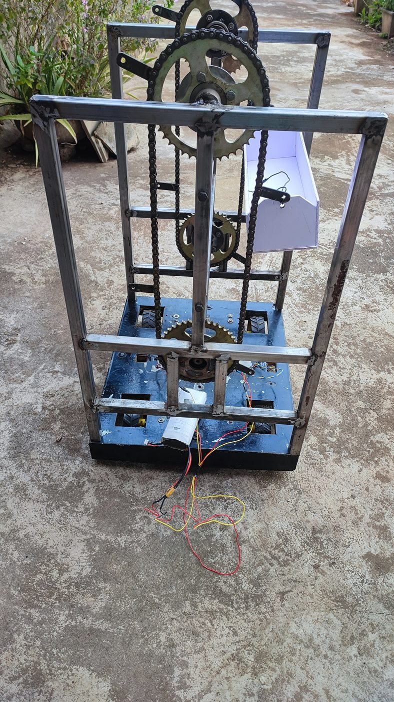
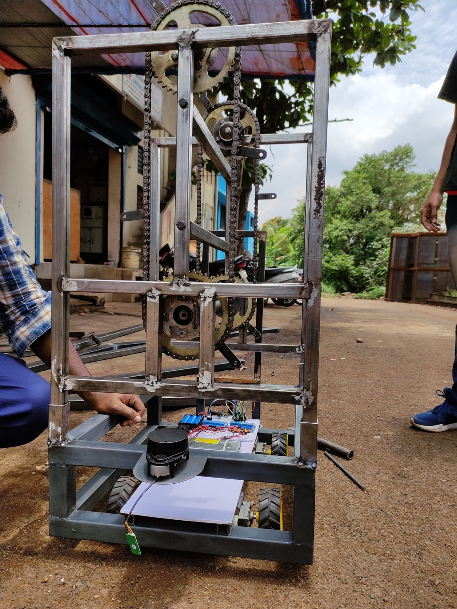
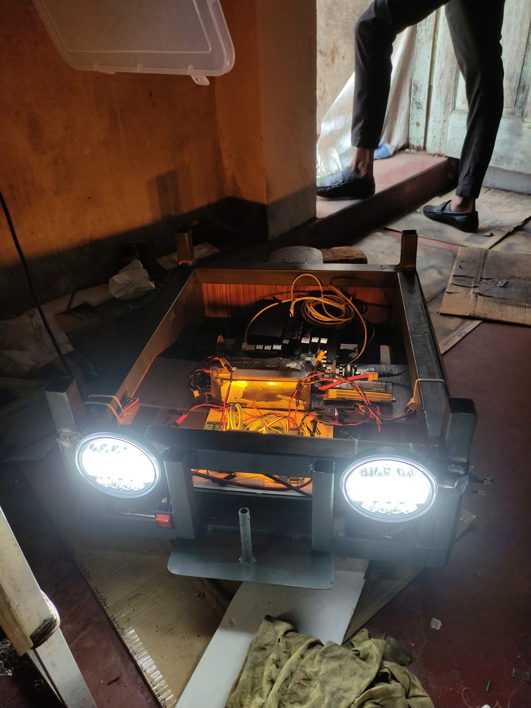
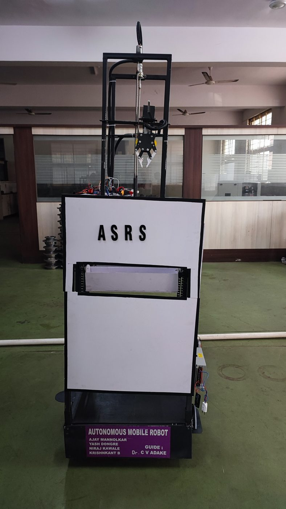
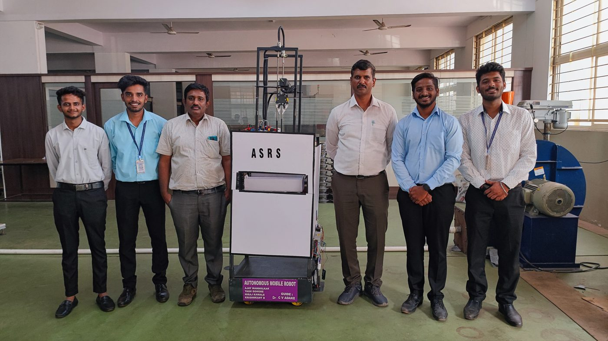

<div align="center">


### 🏭 One robot. Three attachments. Built for the warehouse floor.


</div>

---

## 📌 At a glance

> A multipurpose **Autonomous Mobile Robot (AMR)** for industrial material handling. It drives between stations, senses obstacles, and swaps between three tools — a **fork lifter**, a **vertical carousel storage unit (ASRS)** and a **Cartesian robotic arm** — while operators monitor and override it over **IoT**.

| 🔧 Built | 👥 Team | 🧠 My role | 📏 Footprint |
|:---:|:---:|:---:|:---:|
| 2022 – 2023 | 4 engineers | Team lead · circuit design · hardware build · embedded code | ≈ 500 × 500 × 100 mm |

<div align="center">
  
  <br/>
  <sub><i>Left to right: the mobile base with lead-screw fork lifter · the ASRS storage tower · the Cartesian arm with gripper</i></sub>
</div>

---

## 📑 Contents

- [The problem](#-the-problem)
- [What the robot does](#-what-the-robot-does)
- [System architecture](#-system-architecture)
- [Hardware](#-hardware)
- [The ASRS module](#-the-asrs-module-in-code)
- [Mechanical design](#-mechanical-design)
- [Build journey](#-build-journey)
- [Testing](#-testing)
- [The team](#-the-team)
- [Repository map](#-repository-map)
- [What I learned](#-what-i-learned)
- [Roadmap](#-roadmap)

---

## 🎯 The problem

Small warehouses and workshops still move parts by hand: walk, lift, store, find, retrieve. That's slow, error-prone and hard on people.

**Goal:** one compact, modular platform that can *transport*, *lift*, *store* and *pick* — instead of three separate machines.

---

## ⚙️ What the robot does

<table>
<tr>
<td width="33%" align="center" valign="top">

### 🚜 Fork Lifter
Lead-screw driven forks on the mobile base lift and carry small pallets and crates between stations.

</td>
<td width="33%" align="center" valign="top">

### 🗄️ ASRS Carousel
A chain-and-sprocket vertical carousel stores items in trays. Type a tray number on the keypad and it brings that tray to the window.

</td>
<td width="33%" align="center" valign="top">

### 🦾 Cartesian Arm
X-Y-Z gantry arm with a gripper, driven by NEMA 23 steppers, for precise pick-and-place.

</td>
</tr>
</table>

**Plus:**
- 🧭 **Line following** for repeatable routes between stations
- 🛑 **Obstacle detection** with LIDAR, ultrasonic and IR sensors
- 📱 **IoT remote control** via the Blynk app: drive, switch tools, monitor live
- 🔋 **Battery powered**: 12 V Li-ion with regulated supply rails
- 💡 **LED headlights** for visibility on the shop floor

---

## 🧩 System architecture



---

## 🔌 Hardware

| Subsystem | Components |
|---|---|
| 🧠 **Controllers** | Arduino Mega · ESP8266 (IoT) |
| 👁️ **Sensors** | RPLIDAR · ultrasonic · IR · keypad input |
| 🏎️ **Drive** | DC geared motors + L298N drivers · front caster wheels |
| 🦾 **Arm & lift** | 2 × NEMA 23 steppers + TB6600 drivers |
| 🗄️ **ASRS** | Chain-and-sprocket vertical carousel · servo-controlled tray indexing |
| 🔋 **Power** | 12 V Li-ion battery · SMPS · buck converters (5 V rail) · dual cooling fans |
| 🖥️ **Feedback** | LCD status display · Blynk dashboard |

---

## 💻 The ASRS module in code

The sketch in [`Asrs_code/Asrs_code.ino`](Asrs_code/Asrs_code.ino) runs the storage carousel:

```text
 Operator types tray number on keypad
            │
            ▼
   Arduino reads key  ──►  moveTray(n)
            │
            ▼
   Servo rotates carousel to tray n  ──►  item delivered to the front
```

**Libraries:** `Keypad.h` · `Servo.h`

<details>
<summary><b>▶ How to run it</b></summary>

1. Open `Asrs_code/Asrs_code.ino` in the **Arduino IDE**
2. Install the **Keypad** library (Library Manager); `Servo` ships with the IDE
3. Wire the keypad rows/columns and the servo signal pin as defined at the top of the sketch
4. Select your board, then **Upload**
5. Enter a tray number on the keypad and watch the carousel move

</details>

---

## 📐 Mechanical design

- 🖥️ Designed in **SolidWorks**, load paths checked in **ANSYS**
- 🏗️ Welded **square-tube frames** for the base and the storage tower
- ⛓️ **Chain-and-sprocket drive** moves the carousel trays vertically
- 🔩 **Lead screw** raises and lowers the forks on the mobile base
- 📦 ≈ **500 × 500 × 100 mm** base with bays for electronics, cooling and payload
- 🛞 Two rear drive wheels for traction, casters at the front for stability
- 🔩 **Modular**: mechanical and electrical layers separate for easy maintenance

📄 Full drawings and design report: [`Autonomous Mobile Robot system.pdf`](Autonomous%20Mobile%20Robot%20system.pdf)

---

## 🛠️ Build journey

From raw steel tube to a working warehouse robot — every frame was cut, welded and wired by our team.

<table>
<tr>
<td width="25%" align="center"><br/><b>① Fabrication</b><br/><sub>Cutting and welding the square-tube frame</sub></td>
<td width="25%" align="center"><br/><b>② Carousel mechanism</b><br/><sub>Sprockets and chains fitted to the storage tower</sub></td>
<td width="25%" align="center"><br/><b>③ Sensors & electronics</b><br/><sub>RPLIDAR, drivers and controllers on the base</sub></td>
<td width="25%" align="center"><br/><b>④ Power-up</b><br/><sub>Mobile base wired up, LED headlights on</sub></td>
</tr>
</table>

<div align="center">
  
  <br/>
  <b>⑤ Finished robot</b> — ASRS tower mounted on the autonomous mobile base, on display at KLE Tech
</div>

---

## 🧪 Testing

| Test | What we checked | Result |
|---|---|:---:|
| Line following | Repeatable station-to-station routes | ✅ |
| Obstacle detection | Stops / steers around objects in path | ✅ |
| ASRS carousel | Correct tray reached for each keypad input | ✅ |
| Fork lifter & arm | Full lift and pick-and-place cycles | ✅ |
| Drive & power | Traction and battery performance on different floors | ✅ |
| IoT control | Remote drive, tool switching and telemetry via Blynk | ✅ |

<!-- 🎬 Add a demo video/GIF here:
[](https://youtu.be/YOUR_VIDEO_ID)
-->

---

## 👥 The team

<div align="center">
  
</div>

| Member | |
|---|---|
| **Ajay Mannolkar** | Team lead · circuit design · hardware build · embedded programming |
| **Yash Dongre** | Team member |
| **Niraj Kawale** | Team member |
| **Krishnkant B** | Team member |
| **Dr. C. V. Adake** | Project guide, KLE College of Engineering & Technology |

---

## 🗂️ Repository map

```
📦 Autonomous-Mobile-Robot-with-ASRS-Cartesian-Robot
 ┣ 📂 Asrs_code
 ┃ ┗ 📜 Asrs_code.ino                  ← ASRS carousel control (Keypad + Servo)
 ┣ 📜 ASRS CODE                        ← earlier version of the ASRS sketch
 ┣ 📕 Autonomous Mobile Robot system.pdf  ← project report + SolidWorks designs
 ┣ 🗜️ BlynkESP8266-master.zip          ← Blynk library used for IoT control
 ┣ 📂 media                            ← build photos
 ┗ 📘 README.md
```

---

## 🧠 What I learned

- 🔗 **Systems integration**: making mechanical, electrical and embedded parts work as *one* machine
- ⚡ **Motor control**: choosing drivers, sizing steppers and distributing power safely
- 📡 **Sensor integration** for obstacle detection in a real, noisy environment
- 👥 **Leading a team of 4** from concept through CAD, fabrication and testing

---

## 🚀 Roadmap

- [x] Mechanical design, fabrication and assembly
- [x] Drive, sensing and IoT control
- [x] ASRS carousel, fork lifter and Cartesian arm
- [x] 📸 Add build photos
- [ ] 🎬 Add a demo video
- [ ] 🗺️ Rebuild the navigation stack on **ROS 2** (Nav2 + SLAM) in **Gazebo** simulation — *in progress, I'm currently learning ROS 2*

---

<div align="center">

### 👋 Built by **Ajay Arjun Mannolkar**
M.Sc. Mechatronics & Cyber-Physical Systems · THD Deggendorf

[](https://technolkar.github.io)
[](https://www.linkedin.com/in/ajaymannolkar)
[](https://www.youtube.com/@TechnolkarInnovations)

⭐ *If this project helped or inspired you, consider giving it a star!*


</div>
